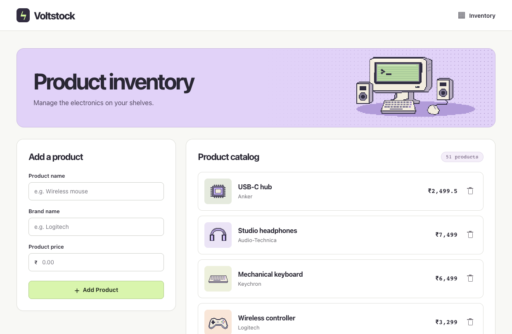

# Voltstock · Electronics Store Management System

Voltstock is a single-page React application for maintaining a store's electronic product records. Each record has a product name, brand, and price in Indian rupees. The first visit opens with 50 removable sample products.

**[Open the live demo on Vercel](https://voltstock-inventory-5154.vercel.app)** · **[Read the LISA project report](output/pdf/LISA-Electronics-Store.pdf)**

## Run locally

Install Node.js 22.12 or later and npm. In a terminal, run the following commands.

```sh
git clone https://github.com/Singh-dps/voltstock-electronics-store.git
cd voltstock-electronics-store
npm ci
npm run dev
```

Open the local address Vite prints in the terminal. To check the production build, stop the development server and run:

```sh
npm run build
npm run preview
```

No API keys, environment variables, or database setup are required.

## Features

- **Add a product.** Enter a name, brand, and positive price with up to two decimal places. The form trims surrounding spaces and rejects blank names or brands.
- **View records.** Each reusable product card displays the name, brand, and formatted price. New records appear first and the count updates immediately.
- **Delete a product.** Use the bin button on its card. A unique ID identifies each record, so two products can share a name.
- **Start again from an empty catalog.** Removing the last product shows an empty-state message. The same form remains available.
- **Keep changes on refresh.** Records use this browser's local storage. Each browser profile maintains its own inventory. If browser storage is unavailable, the page displays a notice and continues working in memory.

Browsers with an earlier, nonempty inventory receive the 47 new sample products once. Previously deleted products stay deleted, and an intentionally emptied catalog stays empty.

## Screenshots

### Inventory with 50 sample records


### After deleting the last record


## Tech stack and component structure

React manages the interface, Vite serves and builds it, and CSS Grid adapts the layout for desktop and mobile. Vercel serves the production build. The pixel-art illustrations were drawn for this project.

| Source file | Responsibility |
| --- | --- |
| `src/main.jsx` | Mounts the React application and loads the stylesheet. |
| `src/App.jsx` | Owns the product array with `useState`, adds and removes records, and chooses between cards and the empty state. A `useEffect` saves changes to browser storage. |
| `src/components/ProductForm.jsx` | Validates input and passes a new record to the parent through `onAdd`. |
| `src/components/ElectronicsCard.jsx` | Receives a product and an `onDelete` callback through props. |
| `src/inventory.js` | Loads saved or sample products and provides the INR price formatter. |
| `src/styles.css` | Defines the responsive layout, visual states, and keyboard focus indicators. |

## Verify the core flow

1. Open the live demo in a fresh browser profile. The catalog shows 50 sample products.
2. Enter **USB-C hub**, **Anker**, and **2499.50**. Select **Add Product**. The new card appears first and the count rises to 51.
3. Reload the page. The new record remains.
4. Delete the hub and check that the 50 other records remain. Delete those records and reload. The page displays **No products available**.
5. Add a product to the empty catalog. Its card replaces the empty message.

## Practical viva walkthrough

1. Open a fresh browser profile and point out the 50 products. In the source, `App` owns the array through `useState(loadInventory)`. Its `map()` call renders one `ElectronicsCard` per product, keyed by ID.
2. Try submitting a blank brand and then a price of zero. HTML form constraints block both submissions. For text containing only spaces, the submit handler trims the value and displays a validation message.
3. Add the USB-C hub from the example above. `ProductForm` sends the record to its parent through the `onAdd` prop. The state updater creates a new array, so React updates the count and renders the card.
4. Reload to demonstrate persistence. Each card receives `product` and `onDelete` as props. Delete the hub and explain how `filter()` removes its ID while retaining every other record.
5. Use the empty-catalog screenshot to illustrate the conditional rendering branch, or remove the remaining records in a disposable browser profile and add a new one.


